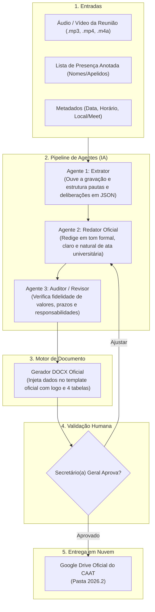

# Gerador Autônomo de Atas — CAAT (Chapa 2026.2)
> **Centro Acadêmico Alan Turing — Engenharia de Computação (UNIFEI)**  
> Automação multi-agente com inteligência artificial para extração, redação regimental, auditoria factual e envio automático de atas de reunião para o Google Drive institucional.

---

## 🎯 Sobre o Projeto

Este sistema foi desenvolvido para a **Secretaria Geral do CAAT** com o objetivo de eliminar o trabalho braçal de redigir atas de reunião, garantindo ao mesmo tempo:
* **Fidelidade Factual Absoluta:** O Agente Revisor cruza as decisões com a gravação original para impedir alucinações.
* **Padronização Visual 2026.2:** O layout oficial (logo do CAAT, quadro de 21 membros com presenças em `[X]`, 4 tabelas regimentais e tópicos numerados) é gerado diretamente em formato `.docx` sem quebras.
* **Contexto Inter-CAs:** Reconhecimento automático das parcerias entre os centros de computação da UNIFEI: **CAAT** (Engenharia de Computação), **CCO** (Ciência da Computação) e **CABIA** (Inteligência Artificial).
* **Upload Direto no Google Drive:** Envio com um clique para a pasta oficial `CAAT > Secretaria > ATAS > 2026.2`.
* **Custo Zero:** Roda 100% dentro dos limites gratuitos permanentes do Google AI Studio e da Google Drive API.

---

## 🤖 Arquitetura Multi-Agente



---

## ⚙️ Pré-requisitos e Instalação

### 1. Clonar o Repositório
```bash
git clone https://github.com/IagoVilela05/Gerador-De-Atas.git
cd Gerador-De-Atas
```

### 2. Instalar as Dependências
Recomenda-se o uso do Python 3.10 ou superior:
```bash
pip install -r requirements.txt
```

### 3. Configurar as Chaves no `.env`
Crie um arquivo `.env` na raiz do projeto (use o `.env.example` como base):
```env
# Chave gratuita do Google AI Studio (https://aistudio.google.com/)
GEMINI_API_KEY=sua_chave_aqui

# Modelo padrão estável e rápido
GEMINI_MODEL=gemini-flash-lite-latest

# ID da pasta 2026.2 no Google Drive oficial do CAAT
GOOGLE_DRIVE_FOLDER_ID=1OsoT8CFqJaTtaGqzl-Z7msEwMIyt-1gb
```

### 4. Configurar o Google Drive (`credentials.json`)
O arquivo de credenciais da aplicação (`credentials.json`) deve ficar na raiz do projeto.
* No primeiro envio de ata, uma aba se abrirá no navegador para autorizar o acesso à pasta do Drive.
* Após autorizar, o arquivo `token.json` será gerado automaticamente e as próximas atas serão enviadas sem precisar de nova autorização.

> ⚠️ **Importante sobre Segurança:** Os arquivos `.env`, `credentials.json` e `token.json` contêm dados de acesso e estão no `.gitignore`. **Nunca os envie para repositórios públicos.**

---

## 🚀 Como Usar no Dia a Dia da Secretaria

### Opção A: Modo Interativo Passo a Passo (Recomendado)
Basta abrir o terminal na pasta e executar:
```bash
python main.py
```
O sistema fará perguntas simples:
1. **Número da Ata:** (já detecta o próximo sequencial automaticamente, ex: 42);
2. **Data e Horários:** (ex: 05/11/2026, 18:30 às 19:50);
3. **Local:** `Google Meet` ou `Presencial`;
4. **Presentes:** Digite ou cole os nomes dos presentes separados por vírgula (ex: `Bernardo, Anna Clara, Fred, Emanuel, Robson, Iago Vilela`);
5. **Transcrição / Áudio:** Cole as anotações ou informe o caminho do arquivo de áudio (`.mp3`, `.wav`) ou gravação de tela (`.mp4`).

---

### Opção B: Linha de Comando Direta (CLI)
Você pode rodar passando os parâmetros diretamente:
```bash
python main.py \
  --numero 41 \
  --data 05/11/2026 \
  --inicio 18:30 \
  --fim 19:50 \
  --local "Google Meet" \
  --audio "caminho/do/audio.mp3" \
  --presenca-arquivo "caminho/presenca.txt"
```

---

## 📋 Como Funciona a Lista de Presença

O sistema possui um cadastro completo dos **21 membros oficiais da Gestão 2026.2** em `src/config.py`.
Você não precisa se preocupar em digitar o nome completo exato:
* Se você digitar `Bernardo`, `Fred`, `Anna Clara` ou `Rodrigo Garcia`, o sistema reconhece automaticamente quem é o integrante.
* O script marca com **`[X]`** a célula de presença de cada um na Tabela 2 do Word oficial e deixa os ausentes em branco.

---

## 📁 Estrutura de Arquivos do Projeto

```
Gerador-De-Atas/
├── ATAS/
│   ├── 2021/ ... 2026.1/      # Acervo histórico de atas do CAAT
│   └── 2026.2/                # Atas da gestão atual (.docx oficiais)
├── templates/
│   └── template_2026_2.docx   # Modelo institucional com logo e tabelas padronizadas
├── src/
│   ├── config.py              # Quadro de 21 membros, cargos e configurações do Drive
│   ├── docx_generator.py      # Motor gerador de Word (.docx) sem quebra de leiaute
│   ├── drive_service.py       # Cliente da API do Google Drive (upload e links)
│   ├── pipeline.py            # Orquestrador dos 3 agentes e cache de extração
│   └── agents/
│       ├── common.py          # Mecanismo de redundância e fallback de modelos
│       ├── extractor.py       # Agente 1: Extrai fatos e decisões do áudio/texto
│       ├── writer.py          # Agente 2: Redige no estilo institucional e natural
│       └── reviewer.py        # Agente 3: Audita consistência factual contra o áudio
├── .env.example               # Modelo de variáveis de ambiente
├── .gitignore                 # Proteção contra envio de chaves e dados sensíveis
├── requirements.txt           # Dependências Python do projeto
├── main.py                    # Interface de execução da Secretaria
└── README.md                  # Este manual de instruções
```

---

## 🏛️ Gestão CAAT 2026.2
Desenvolvido para apoiar a **Secretaria Geral** e a **Diretoria do Centro Acadêmico Alan Turing (UNIFEI)**. Dúvidas ou sugestões de melhorias podem ser alinhadas internamente nos canais oficiais da gestão.
